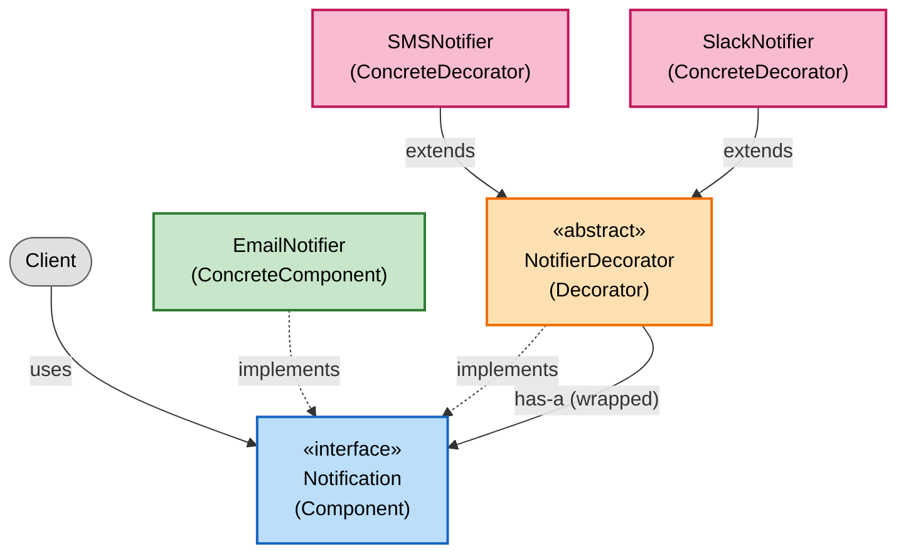
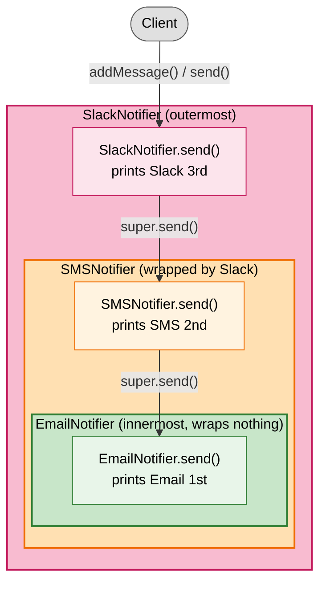

# Decorator Design Pattern

- Lets you add a behaviour to an object dynamically, without modifying the class and without creating a subclass for every combination of feature.
- We can wrap an object inside another object that implements same interface, every wrapper adds it own behaviour before or after delegating to the wrapped object.

## What problem does this design pattern solve? 
- In general, consider that we need to notify a customer about an order via notifications. There are three types of notifications, say, SMS, Email and Slack. 
- To achieve this we create an interface namely `Notification` with methods, `addMessage()` and `send()`.
- We can use a primary `EmailNotifier` which implements `Notification` interface, that sends Email notifications. 
- If a customer has opted-in for other forms of notification, we would also need to send SMS and slack notifications. To achieve this, we would create two separate classes `SMSNotifier` and `SlackNotifier` both of them will implement the `Notification` interface and will be called separately. 
- Here, we are calling `send()`  method individually for each opt-in, this problem can be solved using current pattern.
- Every client that sends a notification must repeat the opt-in checks and the separate calls, so that logic is duplicated everywhere
- Adding a new channel (say, WhatsApp) forces you to edit every one of those call sites.
- If someone later wants to combine channels into one class to avoid this (EmailSMSNotifier, etc.), you land in the class explosion.

## How does it solve this problem? 
- With Decorator pattern we will wrap the objects dynamically instead of calling them separately, let's see how this can be achieved.
- Use the same `Notification` interface as above.  Call it `Component`
    ```
    interface Notification{
        void addMessage(String message);
        void send();
    }    
    ```
- Create a class that implements `Notification` interface, this is the concrete component, in other words, it is the default notification we would send to customer. Call it `ConcreteComponent`

    ```
    class EmailNotifier implements Notification{
        private final List<String> messages = new ArrayList<>();

        public void addMessage(String message){
            messages.add(message);
        }
        public void send(){
            for(String message : messages){
                System.out.println("Sending email : "+ message);
            }
        }
    }
    ```
- Now comes the actual decorator implementation, we create an abstract class that implements `Notification` and holds a `Notification`
    ```
    abstract class NotifierDecorator implements Notification{
        protected final Notification wrapped;
        protected final List<String> messages = new ArrayList<>();
        
        NotifierDecorator(Notification wrapped){
            this.wrapped = wrapped;
        }
        public void addMessage(String message){
            messages.add(message);
            wrapped.addMessage(message);
        }
        public void send(){
            wrapped.send();
        }
    }
    ```
- Create other classes to add behaviour 
    ```
    class SMSNotifier extends NotifierDecorator {
        SMSNotifier(Notification wrapped) { super(wrapped); }

        public void send() {
            super.send();
            for (String message : messages) {
                System.out.println("Sending SMS : " + message);
            }
        }
    }

    class SlackNotifier extends NotifierDecorator {
        SlackNotifier(Notification wrapped) { super(wrapped); }

        public void send() {
            super.send();
            for (String message : messages) {
                System.out.println("Sending Slack : " + message);
            }
        }
    }
    ```
- To see this in action, make a call from a client like below, 

    ```
        public class Main {
            public static void main(String[] args) {
                boolean optedInSms = true;
                boolean optedInSlack = true;

                Notification n = new EmailNotifier(); //Base
                if (optedInSms)   n = new SMSNotifier(n); //wrapped
                if (optedInSlack) n = new SlackNotifier(n); //wrapped
                // the above line can also be written using `Notification n = new SlackNotifier(new SMSNotifier(new EmailNotifier())); if both optins are true`
                n.addMessage("Your order has shipped");
                n.send();
            }
        }
    ```

`Here super(...) calls the parent’s constructor, which is what stores the wrapped field. Since NotifierDecorator has no no-argument constructor, the child must call super(wrapped) explicitly, or it won’t compile.`

### Two details make it wrapping and not just holding a reference:

- **Same interface:** SlackNotifier and SMSNotifier both implement Notification, so the client treats the outermost object as a plain Notification and doesn’t know there are layers inside.
- **Delegation:** Each layer calls wrapped.send() (through super.send() in the abstract class) before doing its own work, so a call on the outer object reaches the inner ones.

The wrapped field in NotifierDecorator is where the wrapped object is stored, and EmailNotifier has no such field because it is the innermost object and wraps nothing.


There are two uses of *super* in this example: super.send() to reuse the parent’s method, and super(wrapped) to initialize the parent’s fields.

You could skip super.send() and write wrapped.send() directly in the child, since wrapped is protected and visible there. It would behave identically. Using super.send() is the more standard choice because it keeps the delegation in one place, so if the abstract class later adds behavior to send(), every decorator picks it up automatically.

## Visualise what we did

### Class structure



### Runtime wrapping

